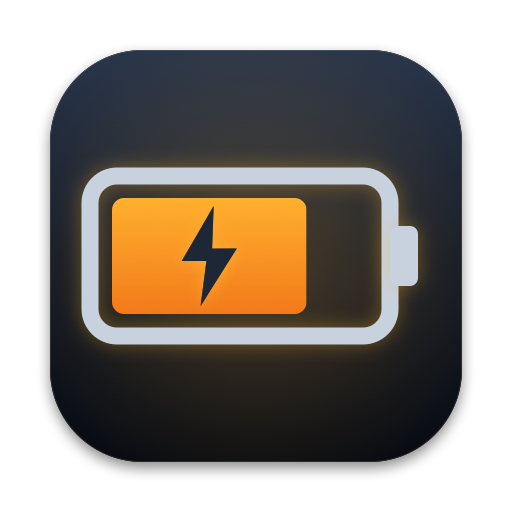

<p align="center">
  
</p>

<h1 align="center">Nimbus UPS Bar</h1>

<p align="center">
  A macOS menu bar guard for using a UPS with externally-powered drives when your host computer
  is a laptop: when the mains fail it watches the UPS, gives the apps a chance to close, and
  cleanly unmounts the external drives before the battery runs out. Everything the UPS reports,
  a chart of load and charge, and a health check, in the dropdown.<br>
  No Dock icon; a menu and a Settings window. Swift, SwiftPM, AppKit. One dependency: our own
  <a href="https://github.com/njoubert/nimbus-updater">nimbus-updater</a>, which keeps it up to date.
</p>

```
./build.sh run            # debug build → dist/debug/Nimbus UPS Bar Dev.app, launch it (add --fg for logs here)
./build.sh stop           # quit it
./build.sh test           # the outage state machine against fakes (swift test)
./build.sh install        # release build → /Applications/Nimbus UPS Bar.app, register its launchd agent, launch
./build.sh uninstall      # unregister the agent, remove the app and its preferences
./build.sh status         # running? installed? agent registered?
./build.sh app            # release build → dist/Nimbus UPS Bar.app only
./build.sh dmg            # release build → dist/NimbusUpsBar-<version>.dmg, drag-to-Applications disk image
./build.sh icon           # re-render docs/icon.png
```

## Why it exists

A MacBook Pro used as a desktop, lid closed, with a Studio Display and an OWC enclosure holding a
four-drive NVMe RAID, all on a CyberPower UPS. When the mains fail, the laptop survives on its own
battery; the enclosure dies the moment the UPS runs out, with whatever was in flight on the RAID.
macOS cannot help: its UPS shutdown thresholds (`pmset -u haltlevel …`) are ignored on any Mac with
an internal battery, by design. So this app does the one job: get the external volumes unmounted,
cleanly, before the UPS dies, and put them back when the power returns. The investigation behind it
is in a handoff folder the owner keeps outside the repository.

## What it does

**In the bar.** A bolt on line power, coloured by the health check: green when the UPS is ready,
yellow when something wants a look, red with a warning badge for a fault, a red struck-out bolt
when no UPS is connected (add the load in watts in Settings › Readings). During an outage
the icon turns orange with the UPS charge and a countdown to the next step, red while forcing,
green with a shield once the drives are safe, blue while remounting.

**The stages**, timed from the first reading on battery. Each of the three that act (closing
apps, unmounting, sleep or shut down) begins at whichever of its conditions comes first: **time on
battery**, **runtime left** at or below a figure, **charge** at or below a percent. Every condition
can be ticked or not, in any combination; the forced unmount needs at least one. While power is
back but not yet trusted (the 30 s below), no stage begins on time: a stage that falls due then
begins at once if the power fails again, and charge and runtime still count.

| Stage | When (defaults) | What happens |
|---|---|---|
| **On battery** | Transfer | A notification with charge and runtime. The Mac is held awake (the "UPS Power" power profile would sleep it after a minute). Nothing is touched: a flicker shorter than the first stage only produces this. Power that comes back has to stay back for 30 s before the outage is over (the headline counts it down); under a brownout that transfers every few seconds the clock and the stages keep running, judged against the last reading on battery. |
| **Closing apps** | 2 min on battery | Every app with files open on a protected volume is sent a quit event, the same thing as its Quit menu, so it saves or shows its own unsaved-changes dialog. Only apps with a Quit menu are asked and waited for: a running application LaunchServices knows, or a helper it started (a browser renderer). Daemons (`smbd`, Spotlight, Backblaze), background-only helpers, and command-line tools are left alone, including the ones that live inside an `.app` (Homebrew's `python3`, the Xcode toolchain behind `git`). As soon as no app holds a volume, that volume is unmounted. With a quit timeout set (off by default), an app still holding its volume that long after the ask has the volume unmounted anyway, unless the power is back by then. With no condition ticked the stage is skipped and the volumes wait for the force. |
| **Unmounting** | 5 min on battery, 10 min runtime or 50 % charge; also the UPS missing (below), the UPS's own alarms (shutdown imminent, below its low-charge limit, its runtime limit expired), or *Unmount Now* | Every protected volume is force-unmounted whether or not an app still holds it. Force only overrides dissenters and open files; the filesystem is flushed completely either way. A volume that still refuses is retried every 10 s, and you are told once. Once begun, the stage stays begun for the outage, even if the charge gauge bounces back above the limit. Without a time condition the stage depends on the UPS's runtime and charge; if the UPS reports neither, 5 min on battery stands in, and Settings says so. |
| **Drives safe** | Everything unmounted | The sleep hold is released. |
| **Sleep or shut down** | Off; any of the three conditions, or as soon as the drives are safe | The volumes are force-unmounted first, then the Mac is put to sleep or shut down, once per outage. If a volume will not come off, a shutdown goes ahead a minute later anyway (macOS unmounts what it can on the way down); a sleep does not, because a sleeping Mac would still have the volume mounted when the UPS dies, so the Mac stays awake and the unmount is retried. Never while power is back but not yet trusted. |
| **Remounting** | Power back | Whatever the guard unmounted is mounted again, if the disk is still attached. If the enclosure rebooted, macOS mounts it itself and the guard notices. |

**If the UPS goes missing from USB** for 10 s (shorter is a re-enumeration, not a lost UPS):
during an outage it usually means its battery ran flat, so the default is to force-unmount
everything at once; the alternative carries on counting the stages' time against the last reading,
and either can also sleep or shut the Mac down. On line power (a pulled cable, a UPS switched off)
an outage would go unseen: the default is a notification; *Nothing* is silent, and *Notify and
unmount everything* forces the volumes off and remounts them when the UPS is back. Only a UPS that
was seen counts: a Mac with none never hears about it.

While an outage runs, the top of the menu offers **Unmount Now**, **Postpone** (5 min by default;
it moves every time condition; the charge and runtime conditions still apply: postponing cannot
talk the battery into lasting longer) and **Don't Quit Apps This Outage**. Readings in the first
15 s on battery are ignored, because some UPSes report 0 % for a moment at the transfer. A relaunch
mid-outage (a crash restart by the agent, an update, toggling *Run in Background*) carries the
outage's clock on rather than starting it again, remounts the volumes the previous copy unmounted
when the power is back, and does not ask the same apps twice.

**In the dropdown.** First the headline: the stage, what comes next and when, and three figures:
charge, load in watts, runtime (the UPS's own estimate at the current load). Top right, how old
those figures are and how often they are read: every 10 s on line power, every 2 s on battery and
while the menu is open, both adjustable (the line/battery state itself arrives from macOS the
moment it changes). Then a chart of the **last hour** (up to a day, in Settings) in two panels on
one time axis, load above and battery charge below, each headed by its newest value, with minutes
on battery tinted and the charge limit (when on) drawn as a dashed line; hover for the values at
any moment. Then:

- **Protected Volumes**: every external volume, with a dot (green mounted, yellow unmounted or
  being worked on, red detached) and which of your processes have files open on it (without root
  macOS shows no one else's: `smbd` serving a share, Spotlight, backup agents). Each has a submenu with *Unmount
  Now* / *Mount*, its UUID, device, mount point, drive model, and the processes holding it.
- **UPS Health**: the checks below, each with a dot, and *Run Battery Self-Test…*, the UPS's own
  ten-second quick test.
- **Inspector…** (⌘I): a window with everything the app knows, live. *Unified* puts every page in
  one table (and its JSON adds the recent changes and the log tail; *Copy All* copies it, the same
  document `--inspect-json` prints). Then a page per section: exactly
  what the UPS returns over USB HID (every element in its report descriptor, decoded where the
  app knows it, each with its type, cookie, report, address, bytes and range, and a failed read
  shown as one; the collections; every report's bytes; the descriptor; the device's properties), the entry macOS keeps for it (`pmset -g ps`) and the Mac's own battery, the health
  checks, the outage guard (phase, countdowns, the policy it runs), the protected volumes and who
  holds them, how the readings are taken (cadence, read counts, failures, power-source events),
  and the background agent and this copy (SMAppService status, the launchd job's state, pid, runs
  and last exit code, the bundle, the version). Each section is a table whose rows flash when a
  value changes, or the same as JSON; *Copy Page* puts the page's JSON on the clipboard, the form
  to paste into an agent. *Search this page* (⌘F) matches plain text, ignoring case, on the
  open page only: the table keeps the matching rows under their headings, the JSON highlights
  the matches (Return steps to the next); *Copy Page* still copies the whole page. *Changes* lists every value that moved
  since the window opened, with the old and the new. *Events* is what the app decided and did,
  newest first, each line with an icon and a colour for its kind (outage, stage, apps, volumes,
  the UPS, problems, rehearsals; the once-a-minute progress lines on request),
  read from the text log `~/Library/Logs/Nimbus UPS Bar/ups-bar.log`, with *Open Log File* and
  *Show in Finder*. While the Inspector is on screen with *Live
  updates* on (the checkbox at the foot of the sidebar), the UPS is read as often as on battery and
  every page follows; off, the pages hold still until *Refresh*.
- **Simulate an Outage**: a **rehearsal** (a pretend outage at 10× speed against the real volumes
  and the real apps holding them, under the current policy; it logs what it would do and touches
  nothing), in four scenarios: the battery draining, a short battery (so the runtime and charge
  conditions fire before the time ones), the UPS lost mid-outage, and the UPS lost on line power;
  and a **drill** (the
  same pretend outage at 5× with real quits, real unmounts and real remounts; it never sleeps or
  shuts down the Mac, and a real outage abandons it).
- **Settings…** (⌘,): the window described next.
- **Run in Background at Login**, the update items, the version, Quit.

**Settings.** Four panes; every change applies at once.

- **Outage**: the policy. A grid of the three stages (ask apps to quit, force unmount, sleep or
  shut down) by the three conditions (time on battery, runtime left, charge), each a checkbox and a
  figure (the charge gauge on this UPS is voltage-derived, see below); whether apps are asked to
  quit and, optionally, how long they get before their volume is unmounted anyway; sleep or shut
  down, and whether also as soon as the drives are safe; what the outage menu's *Postpone* adds;
  what a missing UPS means, during an outage
  and on line power, and after how long; and the apps never asked to quit, picked from the running
  apps or typed as a bundle id or name. With the forced unmount's time on battery unticked, a
  warning sign beside its label explains on hover that the stage then depends on the UPS
  reporting its runtime or charge. Durations are typed as written everywhere else: `90 s`, `2 min`, `1 h 30 min`.
- **Volumes**: all external volumes (the default), or only the ones you check. Volumes seen before
  but not attached now stay in this checklist, so a drive can be chosen while it is unplugged; the
  menu and the Inspector show only attached volumes, plus a chosen one that is missing. Disk images
  and the EFI and boot helper partitions never count as external.
- **Readings**: how often the UPS is read on line power (10 s) and on battery, in a simulation and
  with the menu open (2 s; also the guard's clock); how long charge and runtime are ignored after
  the transfer and how long power must stay back before an outage is over; how much history the
  chart shows (30 min to 24 h); the load in the menu bar.
- **General**: run in the background at login, notifications (and whether macOS lets them
  through, with a button to its settings when it does not), automatic update checks, the log.

**Health.** The health row and the headline name the first thing that is wrong, not just that
something is. Red: no UPS on USB, the replace-battery flag, an overload, a failed self-test,
shutdown imminent. Yellow: on battery, charge below the UPS's warning limit on line power, battery
voltage at or below nominal while not charging (a worn pack floats low), load at 0 % for a
minute (nothing is on the battery outlets?) or above 80 %, line voltage outside or near the edge
of the transfer window, boost or buck active, no USB reading for a minute, notifications blocked
by macOS (the outage banners would never appear), *Run in Background* on while launchd's last
attempt to start the app failed (after a restart nothing would guard the drives). Hollow grey notes that colour nothing:
recharging after an outage, self-test not run yet, notifications turned off in Settings. Green
otherwise, with the figures.

**Persistence.** *Run in Background at Login* registers a per-user launchd agent from the app
bundle (System Settings › General › Login Items › Allow in the Background). It starts the app at
login and restarts it if it ever crashes; a deliberate Quit stays quit. The first launch from
`/Applications` registers it once; turning it off afterwards sticks. Only one copy ever runs: a
second copy asks the first to quit and takes over. The development build (`./build.sh run`) is
*Nimbus UPS Bar Dev*, `com.njoubert.nimbusupsbar.dev`, with its own settings (copied from the
installed copy's on its first run), notification permission and agent: under the release's
identifier it took over the installed copy's Login Items entry, and macOS then refused to start
the installed copy at login.

**Updates.** Through [nimbus-updater](https://github.com/njoubert/nimbus-updater), as in the
sibling apps: once a day, and when the menu opens if the last check is stale, it asks GitHub for a
newer release, downloads it in the background, and the menu offers **Install Update and Relaunch**.
A download is installed only if macOS confirms it is signed by the same Developer ID as the
running copy. *Check for Updates Automatically* turns the daily check off, and with it off the app
never contacts anything: `api.github.com` and `release-assets.githubusercontent.com` are the only
hosts it ever talks to.

## Setting up

1. **Install it**: `./build.sh install`, or drag the app from the disk image to `/Applications`
   and open it once. It registers its background agent and asks to show notifications.
2. **Check the health line.** Open the menu: the headline should name your UPS, the health line
   should be green, and the load should be the watts your desk draws. A load of 0 % means the
   things you care about are plugged into the UPS's surge-only outlets, which the battery does not
   back.
3. **Choose the volumes** (Settings › Volumes). *All external volumes* is right for a desk where
   everything external is on the UPS. Otherwise check the ones that are.
4. **Set the policy** (Settings › Outage). The defaults (ask apps at 2 min; force at 5 min, 10 min
   runtime or 50 %; no timeout for the apps; keep running afterwards) suit a UPS with an hour or
   more of runtime. With a heavy load and a short runtime, tick the runtime condition on the first
   stage too; if an app that hangs on Quit worries you more than losing its unsaved work, give the
   apps a timeout.
5. **Rehearse.** *Simulate an Outage*, each scenario: watch the menu and the log walk through the
   stages in about half a minute without touching anything.
6. **Drill**, with your work saved: the same with real unmounts. The volumes come back by
   themselves at the end.
7. **Pull the plug.** The real test, done at the keyboard with the log open and nothing important
   open on the drives: pull the UPS's wall plug, see the transfer within seconds, plug it back in
   inside a minute and see nothing unmounted; pull it again and wait for the unmount; plug it back
   in and see the remount.

## How it works

- `Sources/UpsGuardCore/` is the state machine with no AppKit and no IOKit: the readings, the
  policy, the phases, the rehearsal and drill wrappers, the simulated UPS. `swift test` drives it
  through 97 scenarios with a fake clock, fake volumes, fake holders and fake actions.
- `Sources/NimbusUpsBarKit/` is the platform layer, a library so its logic can be tested
  without a UPS. `PowerSources.swift` reads macOS's own power-source entries
  (`IOPSCopyPowerSourcesInfo`, what `pmset -g ps` prints) and gets a run-loop notification the
  moment the UPS state changes.
- `UPSHID.swift` reads the UPS over USB HID directly, which is where the load, the input, output and
  battery voltages, the UPS's own low-battery limits, the self-test result and the flags live. A full
  read of every element takes about 30 ms. The one write it ever makes is the self-test start. A
  read that has not come back after 10 s (a USB transaction that never completes) is written off
  and the next starts beside it through a freshly opened device, leaving the stuck one alone.
- `Volumes.swift` keeps the external volumes current through Disk Arbitration and does the unmount
  (force) and mount through it; no `diskutil`. Volumes are identified by their volume UUID, never
  by `diskN`.
- `Holders.swift` finds the processes with files open on a volume with `proc_listpidspath` (what
  `lsof` uses), in about 60 ms, and asks an app to quit through `NSRunningApplication.terminate`,
  a quit Apple event, addressed to the owning app's bundle id so that a helper process (a browser
  renderer) gets its parent asked. Without root it sees only your own processes. An app is a
  process LaunchServices knows with a user interface, or a helper that app started or one of
  its own XPC services; being inside an `.app` is not enough. System services under `/System`
  (Dock, Spotlight, Finder) are never apps to it, while the apps Apple ships there (Preview,
  TextEdit, Safari, Archive Utility) are. Nothing is ever asked through AppleScript.
- `Sources/NimbusUpsBar/Monitor.swift` ties it together on a timer (HID every 10 s on line power,
  every 2 s on battery; both from Settings), keeps the chart's samples, and runs simulations. It
  holds an activity that keeps App Nap from slowing that timer, and saves what a relaunched copy
  needs (the outage's start, the volumes it unmounted, the apps it asked) on every change.
- `swift test` runs 97 outage scenarios against a fake desk (flapping mains, a UPS that drops off
  USB for a moment or for good, a relaunch mid-outage, a volume that refuses to unmount, two volumes
  landing at different times, each stage on each condition, every rehearsal scenario end to end, a relaunch that must remount, a gauge bouncing across the
  limit, …) and 89 checks of the platform layer against fixtures, among them a raw
  dump of the CP1500's 58 HID elements, so the decode, the health rules and the volume filter are
  checked in CI with no hardware attached.

The command line has the same readers and the same guard with no UI:

```
.build/debug/NimbusUpsBar --print          everything the menu would show, as text
.build/debug/NimbusUpsBar --print-menu     the menu itself, built against the real UPS, as a tree
.build/debug/NimbusUpsBar --inspect-json   every Inspector page in one JSON document
.build/debug/NimbusUpsBar --watch          readings and the guard's log as they happen
.build/debug/NimbusUpsBar --simulate [drain|shortBattery|upsLostInOutage|upsLostOnLine]
                                           a rehearsal in the terminal
.build/debug/NimbusUpsBar --holders /Volumes/Flitslig
.build/debug/NimbusUpsBar --volumes
.build/debug/NimbusUpsBar --dump-hid-raw cp1500.json   everything the UPS returns over USB HID, as JSON
.build/debug/NimbusUpsBar --after-safe sleep           sleep (or shutdown), once, after a typed confirmation
```

## Platform facts it rests on

Checked on macOS 27 with a CyberPower CP1500PFCLCDa.

- macOS ignores UPS shutdown thresholds on any Mac with an internal battery (`man pmset`, and the
  check in Apple's `pmconfigd/UPSLowPower.c`).
- The UPS is a USB HID Power Device handled by `ioupsd`; a second, shared open from this app is
  allowed. CyberPower reports battery volts in tenths once the figure has two digits (271 for
  27.1 V), the quirk NUT corrects for; the self-test result uses NUT's mapping (6 = not run).
- A plain unmount of a volume with an SMB share point on it is always dissented by `smbd`, even
  with no client connected. Force overrides that and still flushes. After a remount the share
  point is still there and `smbd` serves it again, but a client that had the volume mounted (the
  Mac Studio, 2026-10-11) keeps a stale mount: Finder there says the original item can't be
  found, and the TCP session stays up, so it never reconnects by itself. Eject it on the client
  and connect again; after a real outage that is needed on every Mac that had it mounted.
- A quit Apple event to an app needs no Automation permission (required-suite events are exempt).
- The "UPS Power" pmset profile sleeps the Mac a minute after the transfer; a
  `PreventUserIdleSystemSleep` assertion holds it awake until the unmount is done.
- When the UPS finally dies, the closed-lid laptop goes to sleep on its own battery (adapter and
  display both vanish). Nothing to do about that, and nothing is at risk by then.

## What a real outage looked like

Plug pulled on 2026-10-10 at 18:25 with Lightroom Classic holding Flitslig, load about 100 W:
transfer seen within seconds; at 2 min 02 s Lightroom was asked to quit and let go within a
second; Flitslig unmounted at 2 min 03 s; power back at 2 min 18 s and Flitslig remounted at once.

The charge gauge went 100 % → 78 % after one minute → 72 % after two, while the runtime estimate
stayed near an hour (66 → 50 → 57 min, following the load). (The guard has since learned to wait
30 s of steady mains before standing down, so today the remount would have come at 2 min 48 s.)
The gauge is not an energy count: on
this UPS it follows the battery voltage, which sags 20–30 % worth in the first minute under load
and then flattens, and climbs back only as the charger brings the voltage up over the following
hours. A hard limit at 50 % therefore fires earlier than "half the energy" suggests, which is the
safe direction; the runtime estimate and the time on battery are the better guides to how long
the drives really have. To see where the gauge settles under your load, pull the plug once with
nothing mounted and watch the chart for ten minutes.

## Before relying on it unattended

The tests cover the decisions; these are the things only the desk can show. Each is a few minutes
at the keyboard, with nothing important open on the drives.

1. **Rehearse, then drill** (*Simulate an Outage*). The drill really unmounts and remounts.
2. **Pull the plug** with the log open: transfer within seconds, the stages at the times the
   policy says, the remount 30 s after power returns.
3. **Pull the USB cable** 30 s into a plug-pull: the headline says "UPS not answering" and nothing
   is unmounted; leave it out and after 10 s everything is, as if the battery had died. Then once
   on line power: a "UPS not seen" notification after 10 s.
4. **Flap it**: plug the wall lead back in for 10 s during a plug-pull, then pull it again. One
   "Power outage" notification, no "Power restored", the clock keeps counting.
5. **A browser holding a file on the drive** during a drill (a download in progress, a file open
   from it): the browser itself is asked to quit, not one of its helper processes. Then a
   Terminal `git` or `python3` writing to the drive: the soft stage neither asks nor waits for it,
   the menu stays responsive, and the volume's submenu lists it as "not an app".
6. ***Unmount Now*** from the menu during a drill.
7. **Sleep and shut down.** `--after-safe sleep` and `--after-safe shutdown` from a terminal,
   each once: both ask for a typed confirmation. For shutdown, watch whether macOS puts up an
   Automation prompt for `loginwindow` the first time; if it does, approve it, because unattended
   that prompt would be a silent no-op. Neither has been run on this desk yet.
8. **The agent.** After `./build.sh install`: `kill -9` the running copy and see it back within
   10 s; toggle *Run in Background* off and on, with `pgrep -x NimbusUpsBar` showing one pid each
   time; `./build.sh run` while the agent is enabled (it quits the agent copy cleanly, and the
   dev copy stays). Then restart the Mac: the icon is back without opening anything, and
   `launchctl print gui/$(id -u)/com.njoubert.nimbusupsbar.agent` says `state = running`.
9. **Launch during an outage** (`./build.sh run` with the plug pulled): the clock resumes from the
   previous copy's start. Relaunch once more after the drives are unmounted: when the power
   returns they are remounted, and the log says the previous copy had unmounted them.
10. **A ten-minute plug-pull** with nothing mounted, to see where the charge gauge settles.
11. **App Nap.** After the app has sat idle for ten minutes, Activity Monitor's App Nap column
    (View › Columns) says No for Nimbus UPS Bar.
12. **Notifications.** After the first launch from `/Applications`, System Settings ›
    Notifications › Nimbus UPS Bar allows them, and the health line does not say
    "notifications blocked".
13. **The enclosure losing power.** With a drill at "Drives safe", switch the enclosure off and on
    again: the log shows the volume going and coming back, and it is mounted again (by macOS or
    the guard).

After every real outage, eject and reconnect the volume on any other Mac that had it mounted over
SMB: its mount goes stale when the guard unmounts the volume and does not recover by itself.

Not covered by anything: a Mac that is already asleep when the outage starts does not run the
guard (on line power this desk never sleeps, so the gap is only a manual sleep); a USB read that
really hangs (the recovery is tested against a fake read that never returns, not against the
UPS); and phase 2,
email notifications for when the desk is unattended, is designed in
`docs/phase-2-email-notifications.md` and not built.

## Licence

GPL-3.0-or-later. Copyright (C) 2026 Niels Joubert.
